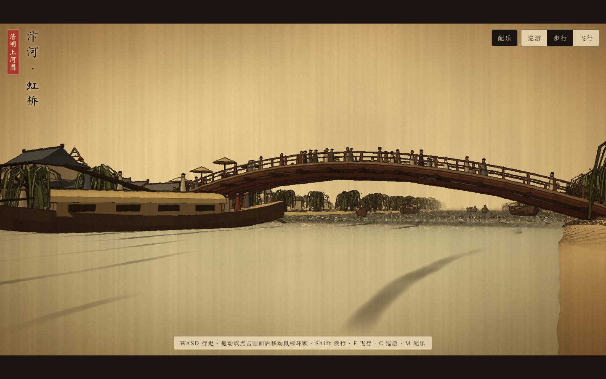
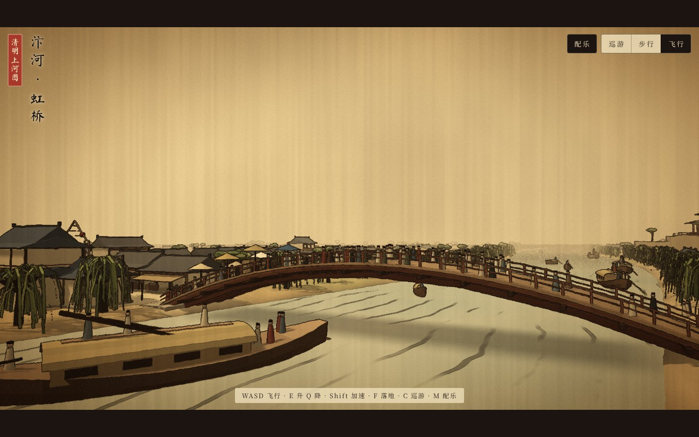

# 清明上河图·汴京漫游

**作者：王路**

把张择端《清明上河图》立成一个可以自由行走的三维世界：绢本设色的色调，墨线勾边，上下遮幅的电影画面，现场合成的筝箫配乐。

## 在线体验

[**点击入画**](https://wanglu2016.github.io/qingming-shanghe-tu/)

不用登录，不用安装。电脑和手机的浏览器都能打开，需要支持 WebGL。

## 项目视频

[**观看完整视频（92 秒）**](https://wanglu2016.github.io/qingming-shanghe-tu/video/qingming-shanghe-tu.mp4) · [GitHub 视频文件](video/qingming-shanghe-tu.mp4) · [下载 MP4](https://github.com/wanglu2016/qingming-shanghe-tu/raw/refs/heads/main/video/qingming-shanghe-tu.mp4)

1280×720，配有王路音色解说和同步中文字幕。画面使用本项目三维场景离屏渲染。





## 画里有什么

自东向西，沿着原画的卷序：

| 地段 | 内容 |
| --- | --- |
| 郊野 | 柳岸、茅舍、田垄、驮炭的驴队 |
| 汴河 | 漕船、小舟、纤夫，放倒桅杆正要过桥的大船 |
| 虹桥 | 木拱桥，桥上伞摊与看船的人群，桥南的“十千脚店”和彩楼欢门 |
| 城门 | 城楼、土墙、出城的驼队 |
| 城内 | “孙羊店”“赵太丞家”等铺面，招幌、轿子、骑马人、围观说书的人群 |

## 怎么用

打开后镜头先沿画卷自动巡游。点「入画漫步」落在虹桥东侧的河岸。

| 方式 | 电脑 | 手机 |
| --- | --- | --- |
| 步行 | WASD 行走，Shift 疾行，拖动或点击画面后移动鼠标环顾 | 左半屏拖动行走，右半屏拖动环顾 |
| 飞行 | F 切换，E 升，Q 降，Shift 加速 | 右上角点「飞行」 |
| 巡游 | C 切换 | 右上角点「巡游」 |
| 配乐 | M 开关 | 右上角点「配乐」 |

配乐是浏览器现场合成的：五声宫调，筝弹分解和弦，箫吹旋律，靠近汴河时有水声。没有音频文件。

## 下载

- 离线版：[qingming-shanghe-tu-site.zip](https://github.com/wanglu2016/qingming-shanghe-tu/raw/main/download/qingming-shanghe-tu-site.zip)，解压后双击 `index.html` 即可，不需要联网。

## 注意事项

- 建筑、舟船和人物是按原画的风格用几何体程序生成的，不是逐笔复刻原画，也没有使用原画的图像。
- 人物是简化的袍服立像，没有四肢动作。
- 画面卡顿时会自动降低清晰度，仍然卡顿则关闭阴影。老旧手机可能不流畅。
- 浏览器要求先有一次点击才能出声，所以配乐在点「入画漫步」或「随卷轴巡游」之后才响。

## 来源与许可

| 内容 | 来源 | 许可 |
| --- | --- | --- |
| 《清明上河图》 | 北宋张择端，故宫博物院藏。本项目只取其布局与画意 | 公有领域 |
| Three.js r128 | https://threejs.org | MIT，见 `assets/three-LICENSE.txt` |
| 马善政毛笔楷书 | Google Fonts | SIL OFL 1.1，见 `assets/fonts/OFL-MaShanZheng.txt` |
| 思源宋体（Noto Serif SC） | notofonts/noto-cjk | SIL OFL 1.1，见 `assets/fonts/OFL-NotoSerifSC.txt` |

两种字体都按页面实际用字裁剪过。

## 目录结构

```
index.html              页面、场景生成、操控、后期与配乐，全部在这一个文件里
assets/three.min.js     Three.js
assets/fonts/           裁剪后的字体与许可
docs/                   截图
download/               离线包
```

## 本地运行

双击 `index.html` 就能运行。也可以起一个静态服务：

```bash
python3 -m http.server 8000
```

然后打开 `http://localhost:8000/`。
